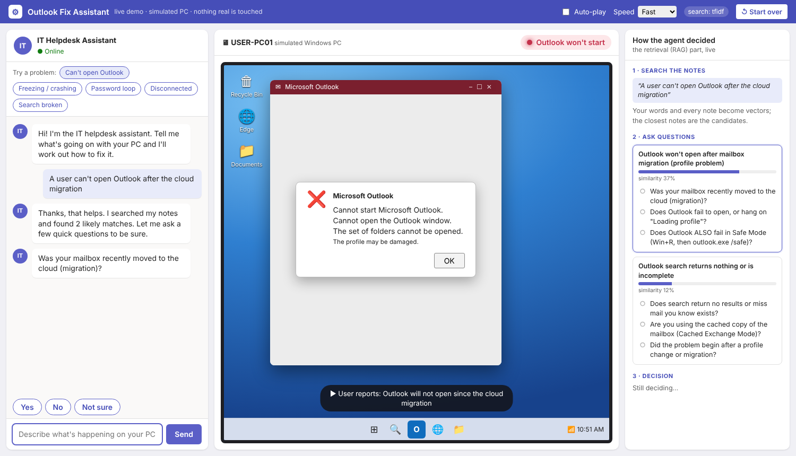
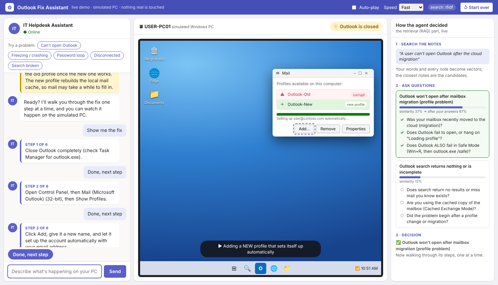
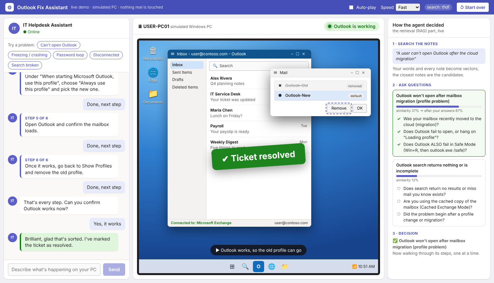

# Outlook Fix Assistant

A guided troubleshooting agent for common Outlook problems, such as a user who cannot open Outlook after a mailbox migration to the cloud. It searches a small set of fix notes (RAG), asks the user questions, then walks through the fix.

It runs in two ways: a **live GUI** (best for showing people) and a **terminal version**. Both use the same notes and the same search. No company data, and the default mode needs no network and no installs.

## Live GUI

```
python webapp.py
```

It opens http://127.0.0.1:8765 in your browser.



- **Left: a Teams-style chat.** The user describes the problem in their own words and the agent asks questions. Quick-reply buttons keep it fast.
- **Centre: a simulated Windows PC.** Watch each fix step happen: Task Manager, Control Panel, the profile list, a cursor clicking the right button, and Outlook going from broken (red) to working (green).
- **Right: how the agent decided.** The notes it retrieved, how similar each one was, the answers you gave, and the final decision.





Controls: **Auto-play** (the simulated user confirms each step for you; turn it off to click through yourself), **Speed**, and **Start over**. The "Try a problem" buttons start a demo in one click.

Everything on the PC screen is a simulation. Nothing touches a real computer.

Options: `python webapp.py --mode auto` (use embeddings if installed), `--port 9000`, `--no-browser`.

## Terminal version

```
python agent.py
```

Type the problem in your own words, for example `outlook is stuck on the loading screen`, answer the yes/no questions, and it walks you through the fix one step at a time.

## How it works (RAG + an agent loop)

1. **Retrieve (the RAG part)** - every note and your question are turned into vectors, and the notes closest to your question are picked (cosine similarity). It looks things up first instead of guessing.
2. **Ask** - ask the best candidates' diagnostic questions. "Yes" raises a note's score, "no" lowers it. If the first note gets "yes" to everything, it stops there.
3. **Decide** - pick the highest-scoring note.
4. **Suggest** - show the warnings, then each step, one at a time.
5. **Verify** - ask whether it worked. If not ("Still broken"), try the next most likely note, then escalate.

### Search modes

| Mode | Command | Needs | How it matches |
|------|---------|-------|----------------|
| `tfidf` (default) | `python webapp.py` | nothing | Word counts, with rare words weighted higher, plus a small stemmer (crashes = crashing). Fully offline. |
| `embeddings` | `python webapp.py --mode embeddings` | `pip install sentence-transformers` | A neural model that matches on *meaning*, not just shared words. The first run downloads ~90 MB, then it is offline. |
| `auto` | `python webapp.py --mode auto` | optional | Uses embeddings if installed, otherwise falls back to tfidf. |

The embeddings mode is written and its plumbing is tested with a fake encoder, but it has not been run against the real model yet. Try it and note how the matches compare with tfidf.

## Safety

The agent never runs anything on a real machine. In the terminal it only suggests and a human does each step. In the GUI everything happens on a simulated PC. This is on purpose: removing a live Outlook profile should not be done by a bot without a person watching.

## The notes

| Note | Problem |
|------|---------|
| 01 | Outlook won't open after migration (add a new profile via Mail (32-bit), then remove the old one) |
| 02 | Slow, freezing, or crashing (bad add-in, Safe Mode) |
| 03 | Keeps asking for a password (Credential Manager) |
| 04 | Disconnected / not syncing |
| 05 | Search returns nothing |

### Adding a new problem

1. Copy a note in `notes/` and keep the layout: a `#` title, a `keywords:` line, then `## Questions`, `## Warnings` and `## Steps`. The agent picks it up automatically.
2. For the GUI, add an entry with the same file name in `web/scenes.json`: the broken starting state, and what the PC shows at each step (see the `_help` line in that file). `python -m unittest` fails if the number of scene steps does not match the note, so they cannot drift apart. A note without a scene still works in the GUI with a plain step window.

## Files

- `webapp.py` - the GUI server and the chat logic (a small state machine)
- `web/index.html` - the whole front-end (chat, simulated PC, decision panel)
- `web/scenes.json` - what the simulated PC shows for each note and step
- `agent.py` - the terminal agent loop
- `retriever.py` - turns text into vectors and finds the closest notes
- `test_agent.py`, `test_webapp.py` - tests

Run the tests with `python -m unittest -v`.

## Ideas for next steps

1. Run `--mode embeddings` and compare it with tfidf on the same sentences.
2. Let an LLM write the follow-up questions and the chat replies instead of using fixed ones.
3. Add more notes and scenes (printing, VPN, Teams sign-in).
4. Log each session (symptom, note chosen, outcome) to see which fixes work.
